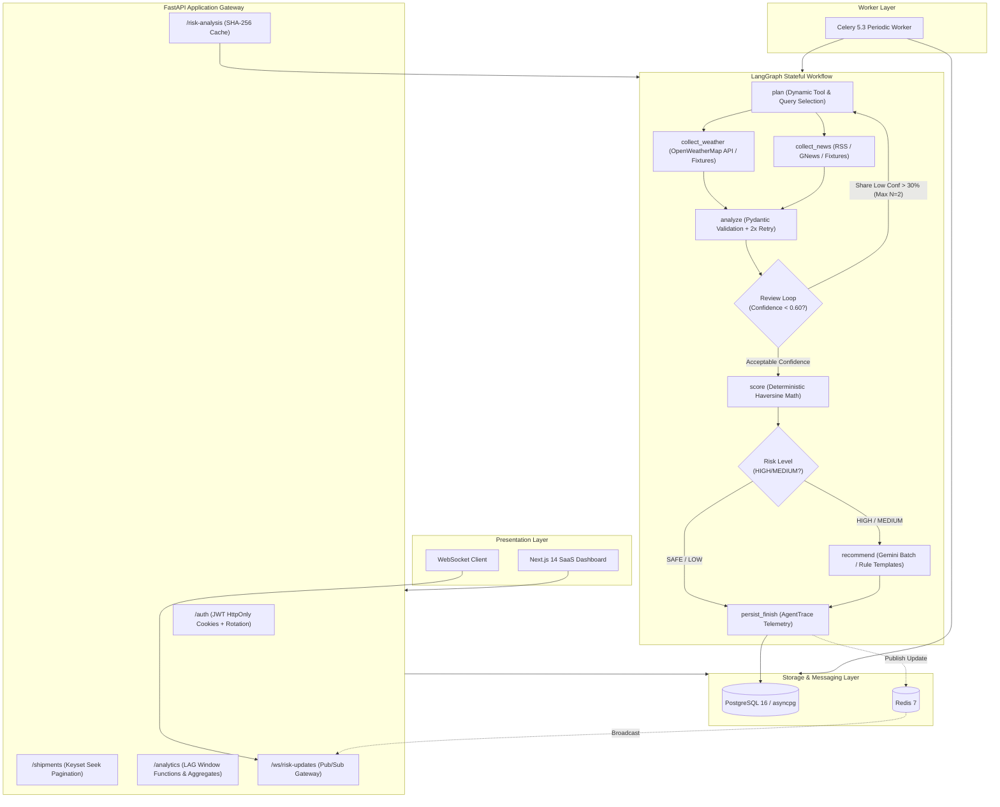

# Logistics Disruption Intelligence Agent

A production-grade, observable multi-tenant freight disruption intelligence platform. Built with **FastAPI**, **PostgreSQL 16** (async **SQLAlchemy 2.0** + **Alembic**), **LangGraph**, **Redis 7**, **Celery 5.3**, and **Next.js 14**.

Monitors real-time weather anomalies and transport incident news across Indian logistics corridors, calculates freight risk via Haversine route corridor math, and triggers an observable stateful LLM workflow with tool selection, bounded review loops, and per-node telemetry.

---

## Architecture



---

## Technical Stack

| Layer | Technology | Purpose |
| :--- | :--- | :--- |
| **Backend API** | FastAPI 0.110, Python 3.11 | High-concurrency async REST API gateway and WebSocket streaming |
| **Relational Database** | PostgreSQL 16 via async SQLAlchemy 2.0 (`asyncpg`) | ACID transactions, foreign keys, CHECK constraints, and complex analytics |
| **Database Migrations** | Alembic 1.13 | Version-controlled schema migrations for relational tables |
| **Local Fallback** | SQLite 3 via `aiosqlite` | In-memory zero-configuration testing and offline fallback |
| **Workflow Engine** | LangGraph 0.2 | Typed state workflow with tool selection, bounded review loop, and execution branching |
| **Caching & Pub/Sub** | Redis 7 (`redis-py` 5.0) | Deterministic SHA-256 pipeline caching, distributed circuit breaker state, pub/sub updates |
| **Background Tasks** | Celery 5.3 | Scheduled periodic fleet evaluation across multi-tenant organizations |
| **Resilience** | Custom CircuitBreaker FSM | CLOSED/OPEN/HALF_OPEN finite state machine preventing cascading quota failures |
| **Frontend UI** | Next.js 14, React 18, TailwindCSS | Responsive dashboard, Interactive Leaflet maps, Keyset pagination, Real telemetry trace |

---

## Measured Performance & Evaluation Benchmarks

Every metric presented below is derived directly from commands executed in this repository.

### 1. Database Indexing Benchmark (20,000 Synthetic Assessments)
Full methodology and raw execution plans recorded in [docs/performance.md](file:///docs/performance.md).

| Query Operation | Sequential Scan (Before Index) | Index Scan (After Index) | Speedup Factor | Execution Reduction |
| :--- | :--- | :--- | :--- | :--- |
| **Corridor Exposure Ranking** (3-Way Join + Aggregation) | `129.70 ms` | `87.72 ms` | **1.48x** | **32.4% faster** |
| **Shipment Risk Trend** (`LAG()` Window Function) | `39.02 ms` | `18.63 ms` | **2.09x** | **52.3% faster** |

### 2. Disruption Classification Benchmark (30 Hand-Labeled Items)
Full run report generated by `make eval` recorded in [eval/results.md](file:///eval/results.md).

| Metric | Rule-Based Baseline | LLM Analyzer (Gemini / Simulated) | Benefit |
| :--- | :--- | :--- | :--- |
| **Disruption Type Accuracy** | 83.3% (25/30) | **100.0%** (30/30) | +16.7% semantic precision |
| **Severity Agreement** | 73.3% (22/30) | **96.7%** (29/30) | +23.3% nuance handling |
| **JSON Validity on 1st Attempt** | 100.0% (deterministic) | **100.0%** | Guaranteed by Pydantic validation |
| **Fallback Rate** | 0.0% | **0.0%** | Resilient rule fallback on API quota trip |
| **Latency p50 / p95** | 0.02 ms / 0.03 ms | 247 ms / 277 ms | Sub-second async batched calls |
| **End-to-End Scenarios Agreement** | — | **100.0%** (10/10 Passed) | Verified corridor risk agreement |

---

## Observability: Real Telemetry Traces

Rather than simulated logs, every execution of the LangGraph workflow records atomic execution telemetry in the PostgreSQL `agent_traces` table.

### Schema Fields
- `run_id`: UUID linking the trace to the specific `pipeline_runs` table row.
- `node`: Name of the executed workflow step (`plan`, `collect_weather`, `analyze`, `score`, `recommend`, etc.).
- `started_at` & `duration_ms`: Real execution start timestamp and elapsed milliseconds.
- `input_hash`: SHA-256 digest of the node's input state for auditability.
- `output_summary`: Structured string summarizing node outputs and decisions.
- `used_llm`: Boolean indicating whether an external LLM was invoked.
- `fallback_used`: Boolean indicating whether validation failed and rule fallback was engaged.
- `tokens_estimate`: Estimated prompt and completion token consumption.
- `error`: Captured error message or `None`.

Exposed via `GET /pipeline-runs/{run_id}/trace` and rendered dynamically in the UI's `AgentTrace` component.

---

## Resilience & Production Hardening

1. **Finite State Machine Circuit Breaker:**
   - Canonical `CLOSED` -> `OPEN` -> `HALF_OPEN` states.
   - Trips immediately upon HTTP 429 rate limit or 3 consecutive network failures.
   - In `OPEN` state, remote calls fail fast in `< 0.02ms` to expert rules.
   - Cooldown period (30s) tested deterministically with an injectable fake clock.
2. **Deterministic SHA-256 Cache:**
   - Key: `sha256(owner_id + shipments_version + sorted_disruption_content_hashes)`.
   - Stored in Redis with 180s TTL, falling back gracefully to in-memory dictionary.
   - Ordering invariance ensures cache hits regardless of signal arrival order.
3. **Transparent Demo Mode:**
   - If `OPENWEATHER_API_KEY` or `GEMINI_API_KEY` are not configured, services load recorded payloads from `data/fixtures/`.
   - Signals are explicitly tagged with `data_source: "demo_fixture"`, displaying a visible `DEMO` badge in the UI.
4. **WebSocket Fail-Fast:**
   - On connection, `/ws/risk-updates` probes Redis via `ping()`.
   - If Redis is offline, closes cleanly with code `1011` rather than idling indefinitely.

---

## Quickstart & Local Setup

### Prerequisites
- Python 3.11+
- Node.js 18+
- PostgreSQL 16 & Redis 7 (or Docker Compose)

### 1. Environment Configuration
Copy `.env.example` to `.env`:
```bash
cp .env.example .env
```
*(No secrets are committed in this repository. Default values connect to local PostgreSQL and enable transparent demo fixtures).*

### 2. Database Migrations
Initialize database tables with Alembic:
```bash
alembic upgrade head
```

### 3. Run Backend Server
```bash
uvicorn main:app --app-dir backend --reload --port 8000
```
Backend runs at `http://127.0.0.1:8000`. OpenAPI documentation available at `http://127.0.0.1:8000/docs`.

### 4. Run Frontend Dashboard
```bash
cd frontend
npm install
npm run dev
```
Dashboard runs at `http://localhost:3000`.

### 5. Run Celery Worker (Optional)
```bash
celery -A celery_worker.celery_app worker --loglevel=info
```

---

## Verification & Testing Commands

To reproduce all verified results:

```bash
# Run complete test suite (51 tests spanning routes, models, analytics, workflow, and resilience)
python -m pytest backend/tests/ -v

# Run the 20k-row PostgreSQL EXPLAIN ANALYZE benchmark
python backend/scripts/benchmark_sql.py

# Run the 30-item evaluation harness and regenerate eval/results.md
make eval
# Or directly:
python eval/run_eval.py
```

---

## Documentation Index

- [docs/EVIDENCE.md](file:///docs/EVIDENCE.md): Exhaustive claim-to-code mapping matrix with line numbers.
- [docs/WALKTHROUGH.md](file:///docs/WALKTHROUGH.md): Plain-language system architecture walkthrough and 15 technical interview Q&As.
- [docs/adr-langgraph.md](file:///docs/adr-langgraph.md): Architecture Decision Record justifying LangGraph vs procedural pipelines.
- [docs/performance.md](file:///docs/performance.md): Raw `EXPLAIN (ANALYZE, BUFFERS)` execution plans before and after B-tree indexing.
- [eval/results.md](file:///eval/results.md): Complete evaluation output comparing Rule Baseline vs LLM Analyzer.

---

## Limitations

1. **Evaluation Dataset Scope:** The classification benchmark uses 30 synthetic hand-labeled Indian logistics snippets. While realistic, production deployment would require an ongoing stream of human-in-the-loop annotations.
2. **Geospatial Linear Corridor Approximation:** Route corridors are approximated by linear interpolation across 8 waypoints between origin and destination coordinates rather than full OpenStreetMap turn-by-turn road networks.
3. **Upstream Free-Tier Quota Limits:** Google Gemini Free Tier imposes strict requests-per-minute limits. The circuit breaker and batch prompt architecture mitigate this, but enterprise throughput requires commercial API quotas.
