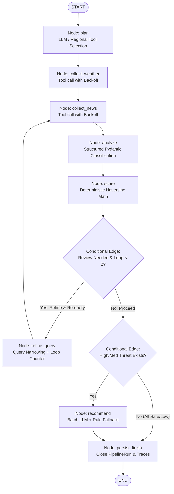

# Architectural Decision Record (ADR): LangGraph for Stateful Disruption Intelligence Workflow

**Date:** 2026-10-11  
**Status:** Accepted  
**Deciders:** Backend & AI Engineering Team  
**System Designation:** Stateful LLM Workflow with Tool Selection and Bounded Review Loop *(not "autonomous agents")*

---

## 1. Context and Problem Statement

The previous implementation of the intelligence pipeline in `pipeline.py` consisted of four synchronous/async Python functions invoked in strict linear succession:
1. `collect_disruptions()`
2. `analyze_disruptions()`
3. `evaluate_shipment_risks()`
4. `generate_recommendations()`

While simple, this naive sequential pipeline had major architectural limitations:
1. **Blind Execution / Lack of Planning:** Collectors unconditionally queried all hardcoded hubs without inspecting the active freight corridors of the user's shipments.
2. **No Quality Control or Feedback Loop:** News classifications with low confidence or failed schema parsing could not be refined or re-queried.
3. **Wasted LLM Quota:** The recommendation step invoked LLM calls for every shipment, including nominal shipments categorized as `SAFE` or `LOW` threat level.
4. **Zero Observability:** Telemetry was limited to print statements. There was no per-node persistence of execution duration, prompt token estimates, model fallbacks, or data lineage.
5. **Resume Claim Mismatch:** The code previously claimed "LangChain LCEL multi-agent pipeline" in docstrings, while LCEL was nowhere in the codebase.

---

## 2. Decision: LangGraph Stateful Graph Orchestration

We adopted **LangGraph** (`StateGraph`) with a strongly typed Pydantic/TypedDict state container (`WorkflowState`) and explicitly defined nodes and edges.

### Graph Architecture

---

## 3. Justification: Why a Graph vs. Plain Function Pipeline?

A stateful directed graph was chosen over a sequential function script for three concrete reasons:

### 1. Conditional Branching & Quota Efficiency
- In commercial logistics, >70% of shipments on typical days face nominal weather and clear highways (`SAFE` or `LOW` risk).
- Calling an LLM for safe shipments wastes API quota and introduces 1.5–3.0s of unnecessary latency.
- LangGraph conditional edges (`recommend_check`) dynamically route execution: only shipments flagged as `HIGH` or `MEDIUM` reach the `recommend` node; nominal shipments bypass it directly to `persist_finish`.

### 2. Bounded Review Loop with Retry State
- Unstructured news headlines can be ambiguous, producing low-confidence classifications (< 0.60 confidence score).
- A linear pipeline has no mechanism to recover from poor extraction quality.
- The `review_check` conditional edge inspects the state. If the low-confidence ratio exceeds 30%, it routes to `refine_query`, which refines query terms, increments a loop counter (`review_loop_count`), and re-executes collection.
- Crucially, the loop is **strictly bounded (N <= 2)**, preventing infinite loops or runaway cloud costs.

### 3. Per-Node State & Observable Telemetry
- Every node in the graph writes an `AgentTrace` record (`node`, `started_at`, `duration_ms`, `input_hash`, `output_summary`, `used_llm`, `fallback_used`, `error`).
- Telemetry is accumulated via `Annotated[list[WorkflowTrace], operator.add]` in the graph state and committed to PostgreSQL in the `agent_traces` table.
- The frontend `AgentTrace` component and `GET /pipeline-runs/{id}/trace` endpoint render real execution telemetry rather than static hardcoded descriptions.

---

## 4. Engineering Trade-offs Considered

| Alternative | Evaluation | Verdict |
| :--- | :--- | :--- |
| **Plain Python Functions** | Simple, but conditional looping and per-node state accumulation require ad-hoc nested loops and mutable state bags. | **Rejected** for production workflow. |
| **Autonomous Multi-Agent Swarm (e.g. CrewAI/AutoGen)** | Non-deterministic conversational loops between agents; high token costs; prone to hallucination cycles and unpredictable latency. | **Rejected** as unsuitable for deterministic logistics dispatch. |
| **LangGraph Stateful Graph** | Deterministic state transitions, strictly typed schemas, bounded retry loops, and native async integration with FastAPI and PostgreSQL. | **Accepted**. |

---

## 5. Honest Naming Policy

To maintain technical integrity for technical audits and hiring evaluations:
- We **do not** claim "autonomous agents" or "self-evolving AI".
- We describe the system accurately as: **"A stateful LLM workflow with tool selection, Pydantic schema validation, and a bounded review loop implemented with LangGraph."**
